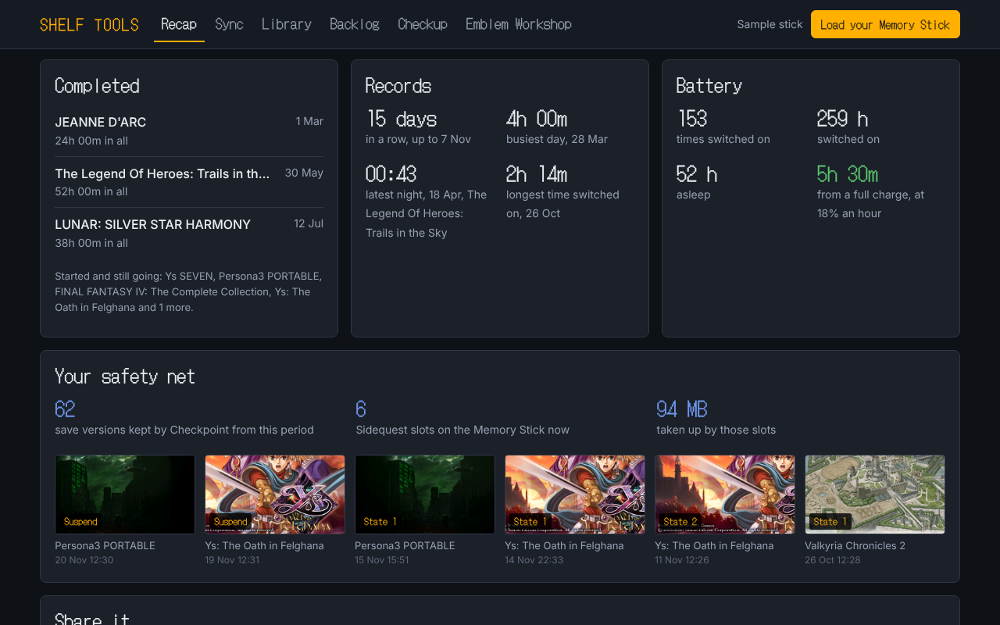
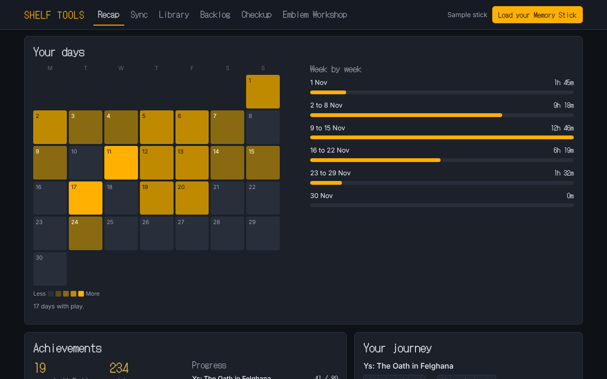
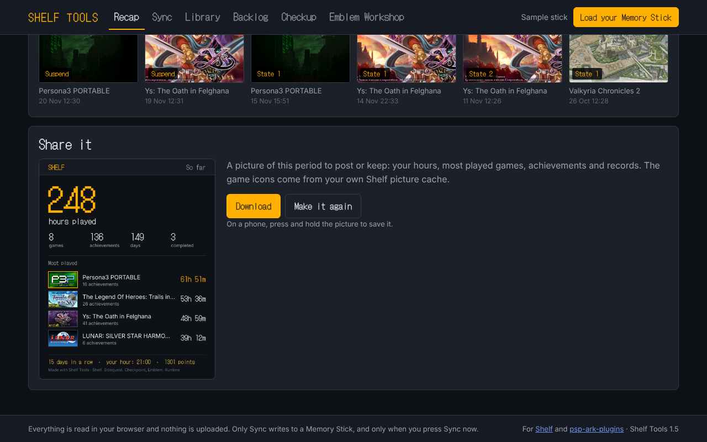
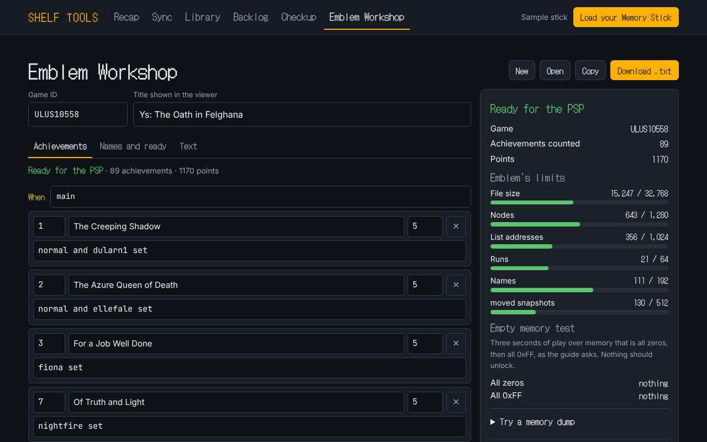
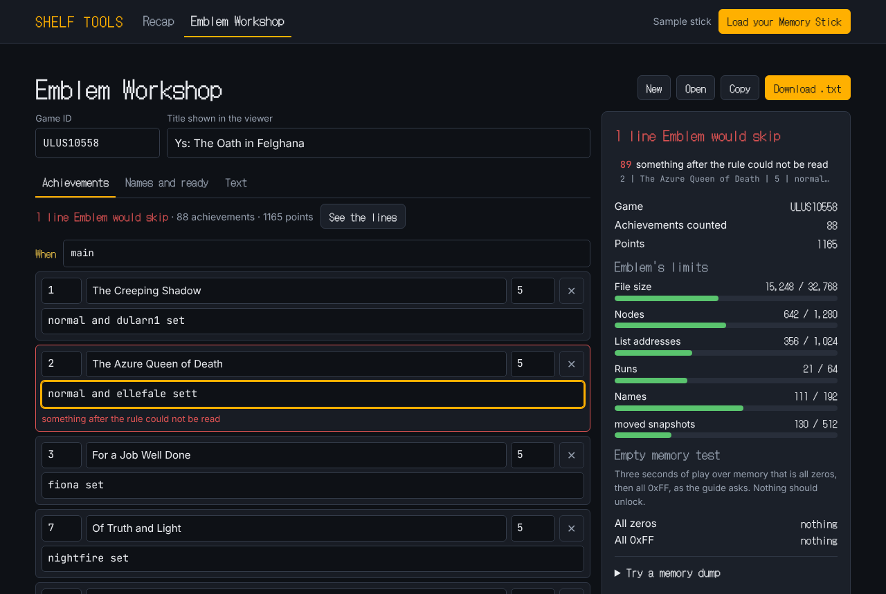
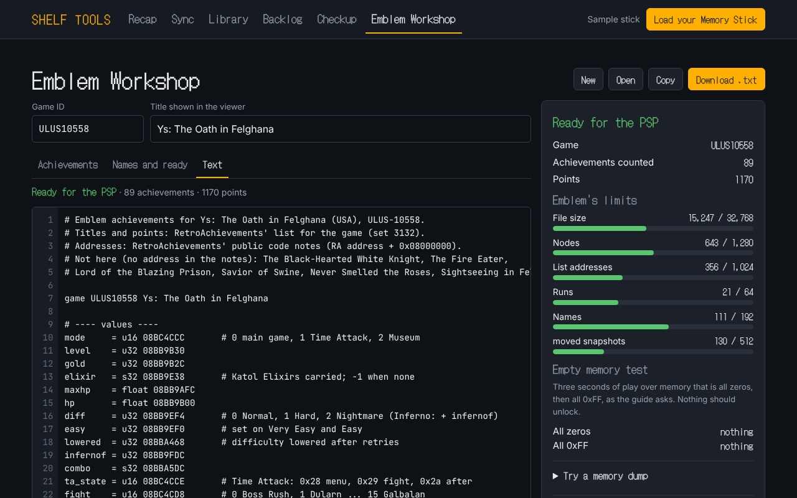
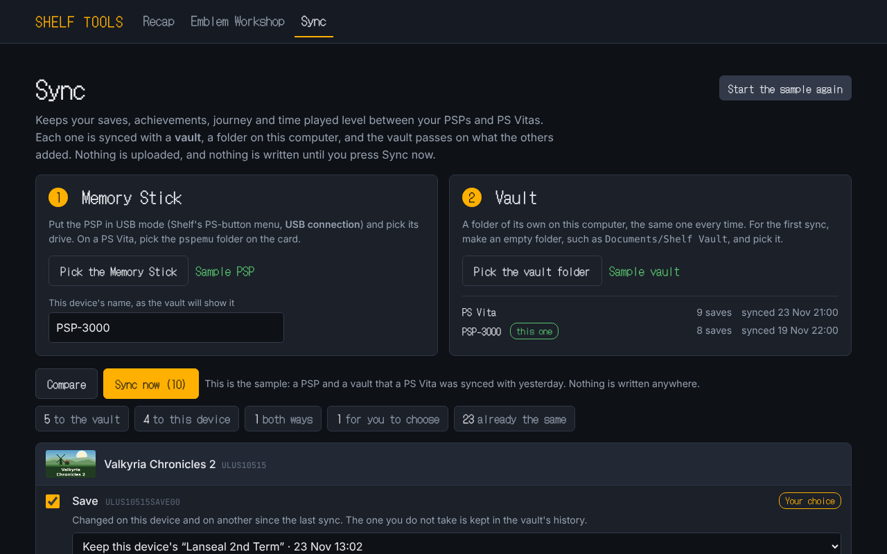
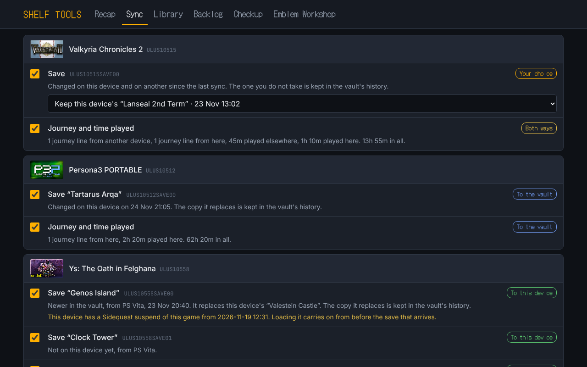
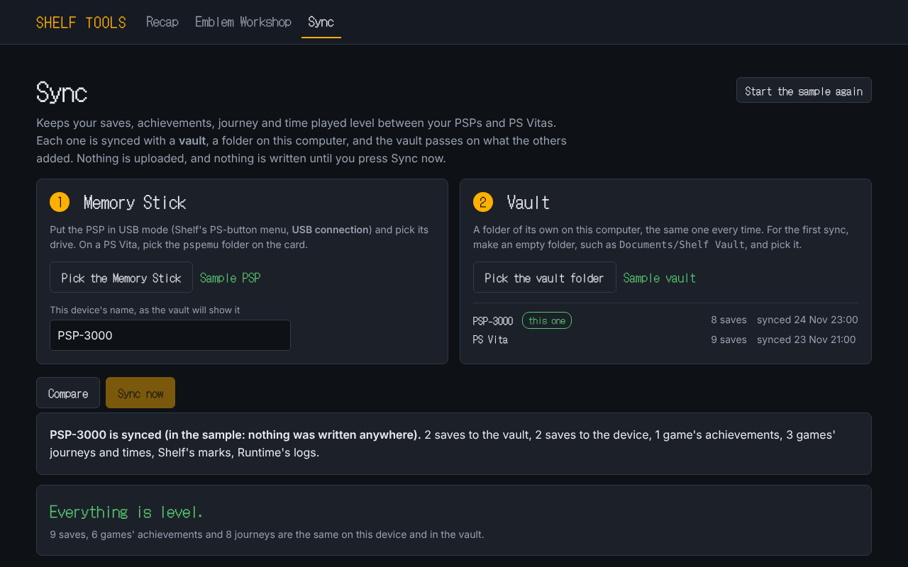

# PSP Shelf Tools

**Shelf Tools** is a web page for the PSP plugins in [psp-ark-plugins](https://github.com/00KAM1/psp-ark-plugins) and the [Shelf launcher](https://github.com/00KAM1/psp-shelf-launcher). It works the same with their PS Vita builds, [psvita-ark-plugins](https://github.com/00KAM1/psvita-ark-plugins) and [psvita-shelf-launcher](https://github.com/00KAM1/psvita-shelf-launcher); see [On a PS Vita](#on-a-ps-vita-adrenaline-8). It has three tools:

- **Recap**: your PSP play for a year, a month or all time, made from what Sidequest, Checkpoint, Emblem, Runtime and Shelf have kept on the Memory Stick.
- **Emblem Workshop**: write and check Emblem's achievement files, with the plugin's own rule engine doing the checking.
- **Sync**: keep your saves, achievements, journey and time played level between your PSPs and PS Vitas, through a folder on your computer.

**Open it: [00kam1.github.io/psp-shelf-tools](https://00kam1.github.io/psp-shelf-tools/)**

It is one page that runs in your browser. Nothing is installed on the PSP and nothing is uploaded. Recap and the Workshop only read. Sync is the one tool that writes to a Memory Stick, and only when you press **Sync now**.

| | |
|---|---|
| Version | 1.4 |
| Reads | Sidequest 1.0+, Checkpoint 1.0+, Emblem 1.0+, Runtime 1.0, Shelf 1.0+, and their PS Vita builds ("1.0 Vita") |
| Syncs | Game saves, Emblem's achievements and game files, Checkpoint's journey and time played, Shelf's favourites and completed marks |
| Tested on | Recap and the Emblem Workshop in Chrome, Chromium and Firefox. Read with the sample Memory Stick, one real Memory Stick and one PS Vita `pspemu` folder (Adrenaline 8, ARK-5) |
| Sync tested on | Chrome and Chromium, where I have run it and it works. Firefox cannot run Sync. The tests cover folders on a PC and Chrome's own folder writing; see [the first time](#the-first-time) |

> **Disclosure.** Shelf Tools was written by Claude, Anthropic’s AI model, from my ideas and my testing with files from my PSP-3000. I’m not a web developer, and nothing has been tested beyond my own setup. Please read the [known issues](docs/known-issues.md) before relying on it.

  

## Recap

Load your Memory Stick and pick a period: all time, a year or a month. Recap shows:

- **Hours played** and your most played games, with their icons from Shelf's picture cache.
- **When you play**: by hour of the day and day of the week, with how many sessions you played and how long they ran.
- **Your days**: a calendar of every day with play, and a month week by week.
- **Achievements** earned with Emblem: their points, the latest ones, and how far along each game's set you are.
- **Your journey**: the places Checkpoint's journey log passed through in each game.
- **Completed** games, from Shelf, and the ones you started and are still playing.
- **Records**: the most days in a row, the busiest day, the latest night and the longest time switched on.
- **Battery**, from Runtime: times switched on, time awake and asleep, and how long a full charge lasts at your rate.
- **Your safety net**: the save versions Checkpoint kept and the Sidequest slots on the Memory Stick, with their pictures.
- **A picture to share**: 1080 × 1350, with your hours, most played games and records.

  
  

  
  

Each plugin adds something, and none is required. With only Checkpoint you get hours and the journey. With only Emblem you get achievements. With only Runtime you get hours for every game (PS1 games and homebrew included), when you play and the battery.

**How time played is counted.** Checkpoint keeps a running total of play time for each game, and Runtime logs every program start. For each game Recap takes whichever of the two saw more, so the same play is never counted twice. The details are in [how it works](docs/how-it-works.md#time-played).

## Emblem Workshop

[Emblem](https://github.com/00KAM1/psp-ark-plugins#emblem) knows a game from one text file in `ms0:/EMBLEM/games/`. The Workshop writes and checks that file.

  

- **The plugin's own engine checks every change.** Emblem's rule engine (`em.c`) is compiled into the page, unchanged. The errors, their line numbers and the counts are the ones the plugin would give on the PSP. The tests check that the page's engine and the plugin's give identical answers on every released game file.
- **Three views of one file**: achievements as rows (number, title, points and rule, under their `when` sections), names and `ready`, and the plain text.
- **Emblem's limits**: file size, nodes, list addresses, runs, names and snapshots, each shown against its limit.
- **The empty memory test** that the [guide](https://github.com/00KAM1/psp-ark-plugins/blob/main/docs/emblem-adding-games.md) asks for: three seconds of play over memory that is all zeros, then all `0xFF`. Nothing should unlock, and a `ready` that holds there is flagged.
- **Things Emblem accepts without a word**: a title longer than 47 characters (Emblem cuts it), an achievement with no title, a game ID with a dash in it, a second `game` line.
- **A memory dump**, if you have one from an emulator: the file runs over it and shows what would unlock, with the `show` values.
- **RetroAchievements addresses**: converts an RA address to Emblem's (+ `0x08000000`), and turns a pasted set of code notes into names of the right size.
- **Open** any of the 42 game files in Emblem's release, a file from your Memory Stick, or a `.txt` from your computer. **Download** gives `<ID>.txt` for `ms0:/EMBLEM/games/`. Your work is kept in the browser between visits.

  
  

## Sync

Play a game on the PSP, carry on with the same save on a PS Vita, and have both show the same hours, achievements and journey. Each device is synced with a **vault**, a folder on your computer that holds the newest of everything. The devices never need to meet: what one adds to the vault reaches the others the next time each of them is synced.

  

1. Put the PSP in USB mode and choose **Pick the Memory Stick**. On a PS Vita, pick the `pspemu` folder on the card.
2. Choose **Pick the vault folder**. The first time, make an empty folder for it, such as `Documents/Shelf Vault`. Use the same folder every time, for every device.
3. The page compares the two and lists what would move, game by game. Untick anything you want left alone.
4. Press **Sync now**. When it says everything is level, eject the Memory Stick as usual.

| Synced | How two sides become one |
|---|---|
| **Game saves** (`PSP/SAVEDATA`) | The side that changed since the last sync wins. If both changed, you choose, with each save's own description and date in front of you |
| **Achievements** (Emblem) | Joined. One earned on both keeps its first date |
| **Journey and time played** (Checkpoint) | Journey lines are joined in date order. Play on each device since its last sync is added up, so the total is the same everywhere |
| **Favourites, completed, hidden, last started** (Shelf) | By disc ID, so a game is found whatever its file is called on each device |
| **Emblem's game files** | As saves, so a file from the Workshop reaches every device |
| **Runtime's logs** | Copied to the vault only, kept apart for each device. They describe one device's battery |

  
  

**What it will not do**

- **Sidequest's states and suspends are left alone.** A state only loads on the device that made it. If a save is about to arrive for a game that has a suspend or state on this device, the page says so: loading that state carries on from before the save.
- **No save is ever deleted.** A save removed from a device stays in the vault, and is not put back on that device unless you tick it.
- **A save that is replaced is kept.** The vault's `SYNC/history` holds the last 5 copies of each save that Sync replaced, on either side.
- **Only game saves are taken**: folders in `PSP/SAVEDATA` whose name starts with a disc ID. ARK's own folder, and anything over 32 MB (installed game data), are never touched.
- **Other devices' plugin files are not forced on a device**: one without Emblem, Checkpoint or Shelf gets saves only.

**It needs Chrome, Edge or another Chromium browser on a computer.** Brave has folder writing switched off until you turn on **File System Access API** under `brave://flags`. Firefox and Safari cannot write to a folder from a web page; Sync says so there, and **Try it on the sample** still shows how it works. Chrome on Android can open folders too, but Sync has not been tried on a phone. The browser asks before it lets the page read and change each folder, and asks again on your next visit.

### The first time

I have run Sync in Chrome and Chromium, and it works there. Its tests cover folders on a PC and Chrome's own folder writing. It is new and it writes to your saves, so the first time:

- **Copy `PSP/SAVEDATA` from each device to your computer first**, somewhere other than the vault.
- Or try it on a copy: copy the Memory Stick's folders to your computer and pick that copy as the Memory Stick.
- Read the plan before pressing Sync now. On a first sync every save goes to the vault, and nothing on the device is replaced without being listed.

The details, including what happens when a sync is cut short, are in [how it works](docs/how-it-works.md#sync) and the [known issues](docs/known-issues.md#sync).

*The pictures on this page are screenshots of the page itself, all taken at 1280 × 800, with the made-up sample year of play over the icons and pictures of my own games. Sync's pictures show the sample's own drawn icons.*

## Loading your Memory Stick

1. On the PSP, open Shelf's PS-button menu and choose **USB connection** (or use the XMB's USB mode).
2. On the page, choose **Load your Memory Stick** and pick the Memory Stick's drive, or drag the drive onto the page.

If the browser will not open the drive itself, select the five plugin folders in your file manager and drag them onto the page together.

Only the five plugin folders are read: `SIDEQUEST`, `CHECKPOINT`, `EMBLEM`, `RUNTIME` and `SHELF`. ISOs, game saves and everything else are skipped, and only the first 404 bytes of a save state are read. A file that cannot be read is skipped, and the page says which.

**On a phone**, a folder often cannot be picked. Zip the five folders on a computer and pick the zip. Leaving `SIDEQUEST` out makes the zip much smaller and only costs the slot pictures.

The page opens on a **sample Memory Stick**: a made-up year of play for real game titles, with pictures drawn for the sample. Recap says so while it is showing.

## On a PS Vita (Adrenaline 8)

The plugins and Shelf have PS Vita builds, made for ARK-5 inside [Adrenaline 8](https://github.com/isage/Adrenaline). They are built differently from the PSP ones and have their own repositories: [psvita-ark-plugins](https://github.com/00KAM1/psvita-ark-plugins) and [psvita-shelf-launcher](https://github.com/00KAM1/psvita-shelf-launcher). Shelf Tools is the same page for both and reads a Vita's files the same way; the only difference is where they are.

On a Vita the PSP's Memory Stick is a folder: `ux0:pspemu`, or wherever **Memory Stick Location** in Adrenaline's menu points. `SHELF`, `CHECKPOINT`, `EMBLEM`, `SIDEQUEST`, `RUNTIME`, `ISO`, `PSP` and `seplugins` are inside it.

1. Reach the card from your computer in one of these ways:
   - Shelf's own **USB connection**. It gives the computer the card chosen as **USB device** in Adrenaline's menu (hold the PS button > Settings), which must be the card that holds your `pspemu` folder: Memory Card for a Sony card, sd2vita for an SD2Vita, and so on.
   - VitaShell's USB mode.
   - FTP with VitaShell, copying the `pspemu` folder (or the five plugin folders in it) to the computer.
2. On the page, choose **Load your Memory Stick** and pick the `pspemu` folder, not the card's root.

**If the computer asks to format the card, do not format it.** The wrong **USB device** is chosen: eject the card, change the setting in Adrenaline's menu, and connect again.

## Using it without GitHub

`index.html` is the whole tool. Download it and open it from your computer; it works offline, except that the fonts then fall back to your system's.

## Hosting your own copy on GitHub Pages

The page needs no server and no build on GitHub's side. In your fork: **Settings → Pages → Build and deployment → Deploy from a branch → `main`, `/ (root)` → Save**. A minute later it is at `https://<your name>.github.io/psp-shelf-tools/`.

## Building and testing

The page is built from `src/` into `index.html` by `tools/build.py`. Commit `index.html` with every change: it is what GitHub Pages serves.

| Script | Does |
|---|---|
| `tests/run_tests.sh [../psp-ark-plugins]` | All PC tests: the copies of Emblem's files match the plugins repo, the page's engine matches `em.c` built with gcc, the Memory Stick reader (a folder, a zip and dropped folders), Recap's numbers, and Sync run on real folders (a PSP, a PS Vita and a vault through first syncs, play on each, a save changed on both, and syncs cut short). Then it builds the page |
| `tests/browser_check.py` | Optional: clicks through the built page in headless Chrome (Playwright), and runs Sync through the browser's own folder writing |
| `tools/sync_from_plugins.sh ../psp-ark-plugins` | After Emblem changes: copies `em.c`, `em.h` and the game files, rebuilds the engine and the page |
| `engine/build.sh` | `em.c` to `src/emblem-engine.js`: clang to WebAssembly, then binaryen's wasm2js to plain JavaScript |
| `tools/make_sample_stick.py` | The sample Memory Stick in `tests/sample/ms0` |
| `tests/render/doc_pictures.py [--only recap\|workshop\|sync]` | The pictures in `docs/images`, all at 1280 × 800. With `tools/make_sample_stick.py --art <folder>` run first, they show your own games' icons and pictures (the folder holds one sub-folder per game with its `PARAM.SFO`, `ICON0.PNG` and `PIC1.PNG`, taken from your ISOs). That stick and its page stay in `tests/docrun/`, which Git ignores |

Needs: python3 with Pillow, node 18 or later, gcc; for the engine, clang with the wasm32 target.

**Documentation:** [How it works](docs/how-it-works.md) · [Known issues](docs/known-issues.md) · [Changelog](CHANGELOG.md)

## Licence

MIT, see [LICENSE](LICENSE). `engine/em.c` and `em.h`, and the game files in `games/`, are Emblem's, from [psp-ark-plugins](https://github.com/00KAM1/psp-ark-plugins) (MIT). The fonts, DotGothic16, Inter and JetBrains Mono, load from Google Fonts under the SIL Open Font License.

The game icons and pictures that appear in the screenshots under `docs/images` are the artwork of the games' publishers, taken from my own copies of those games and shown the way Shelf Tools displays them. They are not covered by this repository's licence. No game files are in this repository, and the sample Memory Stick built into the page uses pictures drawn for it, not game art.

Achievement titles and points in `games/` come from the [RetroAchievements](https://retroachievements.org) sets, and the addresses from their public code notes. Shelf Tools is not connected to RetroAchievements.

## Thanks

| Thanks to | For |
|---|---|
| **RetroAchievements** and its developers ([retroachievements.org](https://retroachievements.org)) | The achievement sets and the public code notes that Emblem's game files, and the Workshop's address helper, are built on. |
| **LLVM** and **Binaryen** ([github.com/WebAssembly/binaryen](https://github.com/WebAssembly/binaryen)) | Turning Emblem's C engine into JavaScript, so the page checks files exactly as the plugin reads them. |
| **DotGothic16** by Fontworks, **Inter** by Rasmus Andersson, **JetBrains Mono** by JetBrains | The page's lettering. |

The PSP side is in [psp-ark-plugins](https://github.com/00KAM1/psp-ark-plugins) and [psp-shelf-launcher](https://github.com/00KAM1/psp-shelf-launcher).
