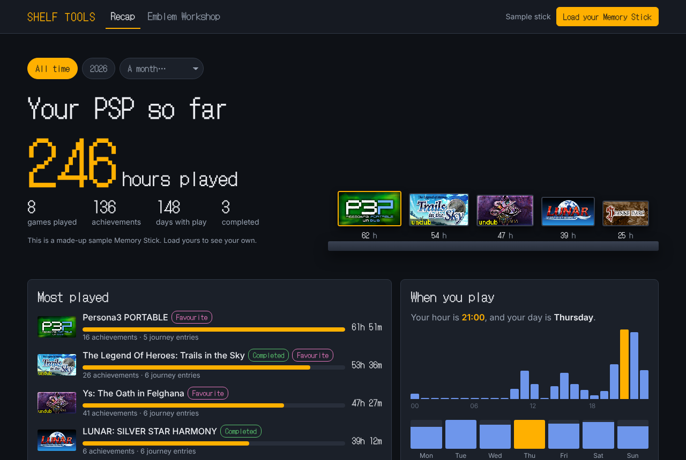
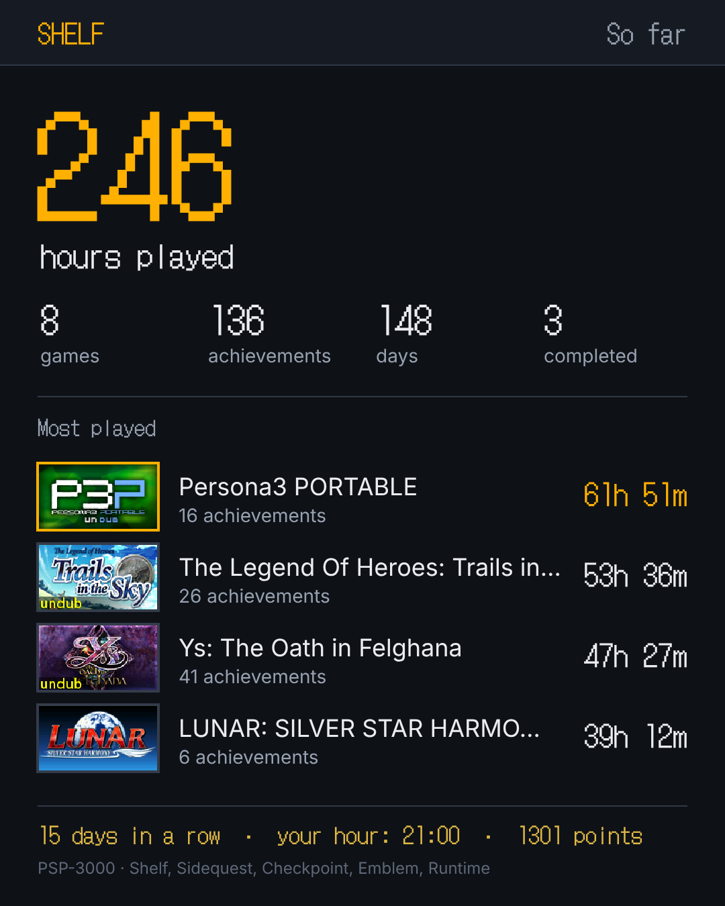
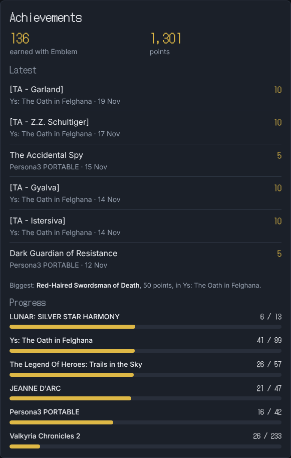
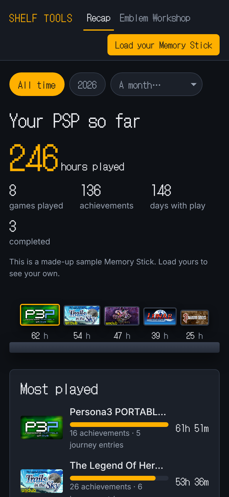
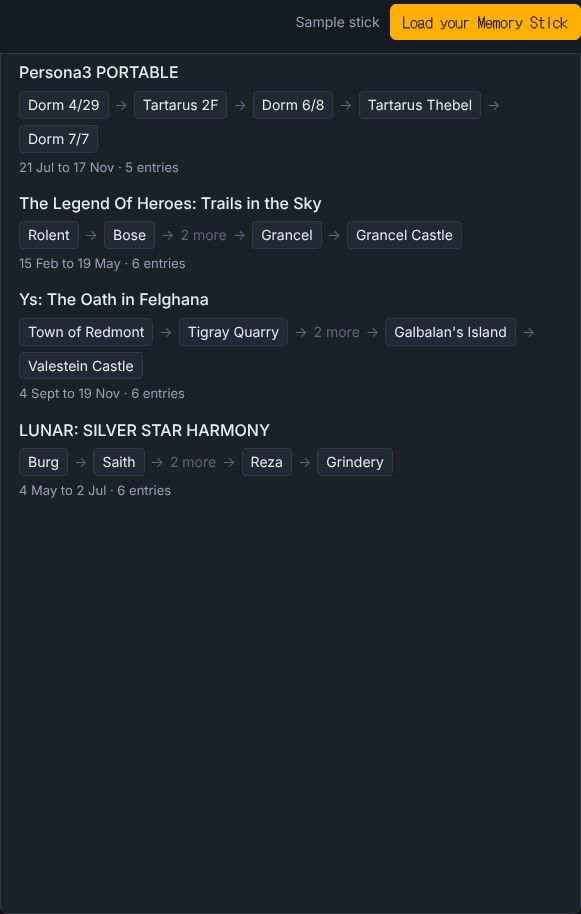
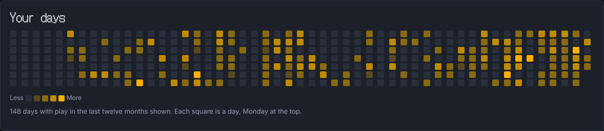
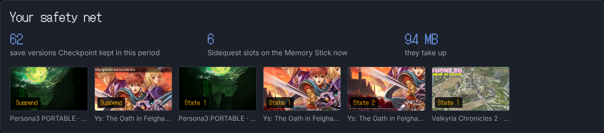

# PSP Shelf Tools

**Shelf Tools** is a web page for the PSP plugins in [psp-ark-plugins](https://github.com/00KAM1/psp-ark-plugins) and the [Shelf launcher](https://github.com/00KAM1/psp-shelf-launcher). It has two tools:

- **Recap**: your PSP play for a year, a month or all time, made from what Sidequest, Checkpoint, Emblem, Runtime and Shelf have kept on the Memory Stick.
- **Emblem Workshop**: write and check Emblem's achievement files, with the plugin's own rule engine doing the checking.

**Open it: [00kam1.github.io/psp-shelf-tools](https://00kam1.github.io/psp-shelf-tools/)**

It is one page that runs in your browser. Nothing is installed on the PSP, and nothing on your Memory Stick is uploaded or changed.

| | |
|---|---|
| Version | 1.0 |
| Reads | Sidequest 1.0+, Checkpoint 1.0+, Emblem 1.0+, Runtime 1.0, Shelf 1.0+ |
| Tested on | Chrome (desktop and phone sizes), with the sample stick |

> **Disclosure.** Shelf Tools was written by Claude, Anthropic’s AI model, from my ideas and my testing with files from my PSP-3000. I’m not a web developer, and nothing has been tested beyond my own setup. Please read the [known issues](docs/known-issues.md) before relying on it.

  

## Recap

Load your Memory Stick and Recap shows, for the period you pick:

- **Hours played** and your most played games, with their icons from Shelf's picture cache.
- **When you play**: by hour of the day and by day of the week.
- **Your days**: a calendar of every day with play.
- **Achievements** earned with Emblem, their points, the latest ones, and how far along each game's set you are.
- **Your journey**: the places Checkpoint's journey log passed through, per game.
- **Completed and started** games, from Shelf.
- **Records**: the longest run of days in a row, the busiest day, the latest night, the longest time switched on.
- **Battery**: times switched on, time awake and asleep, and how long a full charge lasts at your rate, from Runtime.
- **Your safety net**: the save versions Checkpoint kept and the Sidequest slots on the stick, with their pictures.
- **A picture to share**: 1080 × 1350, with your hours, top games and records.

  
  
  

  
  

  

Each plugin adds something; none is needed. With only Checkpoint you get hours and the journey; with only Emblem, achievements; with only Runtime, hours for every game (PS1 and homebrew included), when you play and the battery.

**How time played is counted.** Checkpoint's journey keeps a running total of play time for each game, and Runtime logs every program start. For each game Recap takes whichever of the two saw more, so the two are never added together. The details are in [how it works](docs/how-it-works.md#time-played).

## Emblem Workshop

[Emblem](https://github.com/00KAM1/psp-ark-plugins#emblem) knows a game from one text file in `ms0:/EMBLEM/games/`. The Workshop writes and checks that file.

  

- **The plugin's own engine checks every change.** Emblem's rule engine (`em.c`) is compiled into the page, unchanged. The errors, their line numbers and the counts are the ones the plugin would give on the PSP. The tests check that the page's engine and the plugin's give identical answers on every released game file.
- **Three views of one file**: achievements as rows (number, title, points, rule, under their `when` sections), names and `ready`, and the plain text.
- **Emblem's limits**: file size, nodes, list addresses, runs, names and snapshots, each with its limit.
- **The empty memory test** that the [guide](https://github.com/00KAM1/psp-ark-plugins/blob/main/docs/emblem-adding-games.md) asks for: three seconds of play over memory that is all zeros, then all `0xFF`. Nothing should unlock, and a `ready` that holds there is flagged.
- **A memory dump**, if you have one from an emulator: the file runs over it and shows what would unlock, and the `show` values.
- **RetroAchievements addresses**: converts an RA address to Emblem's (+ `0x08000000`), and turns a pasted set of code notes into names with the right size.
- **Open** any of the 42 game files in Emblem's release, a file from your Memory Stick, or a `.txt` from your computer. **Download** gives `<ID>.txt` for `ms0:/EMBLEM/games/`. Your work is kept in the browser between visits.

*The pictures on this page are screenshots of the page itself, with the made-up sample year of play over the icons and pictures of my own games.*

## Loading your Memory Stick

1. On the PSP, open Shelf's PS-button menu and choose **USB connection** (or use the XMB's USB mode).
2. On the page, choose **Load your Memory Stick** and pick the Memory Stick's drive, or drop it on the page.

If the browser will not open the drive itself, select the five plugin folders in your file manager and drag them onto the page together.

Only the five plugin folders are read: `SIDEQUEST`, `CHECKPOINT`, `EMBLEM`, `RUNTIME` and `SHELF`. ISOs, game saves and everything else are skipped, and of a save state only the first 404 bytes are read.

**On a phone**, a folder often cannot be picked. Zip the five folders on a computer and pick the zip. Leaving `SIDEQUEST` out makes the zip much smaller and only drops the slot pictures.

The page opens on a **sample Memory Stick**: made-up play for real game titles, with drawn stand-in pictures. Recap says so while it is showing.

## Using it without GitHub

`index.html` is the whole tool. Download it and open it from your computer; it works offline, except that the fonts then fall back to your system's.

## Hosting your own copy on GitHub Pages

The page needs no server and no build on GitHub's side. In your fork: **Settings → Pages → Build and deployment → Deploy from a branch → `main`, `/ (root)` → Save**. A minute later it is at `https://<your name>.github.io/psp-shelf-tools/`.

## Building and testing

The page is built from `src/` into `index.html` by `tools/build.py`. Commit `index.html` with every change: it is what GitHub Pages serves.

| Script | Does |
|---|---|
| `tests/run_tests.sh [../psp-ark-plugins]` | All PC tests: the copies of Emblem's files match the plugins repo, the page's engine matches `em.c` built with gcc, the stick reader (folder and zip) and Recap's numbers, then builds the page |
| `tests/browser_check.py` | Optional: clicks through the built page in headless Chrome (Playwright) |
| `tools/sync_from_plugins.sh ../psp-ark-plugins` | After Emblem changes: copies `em.c`, `em.h` and the game files, rebuilds the engine and the page |
| `engine/build.sh` | `em.c` to `src/emblem-engine.js`: clang to WebAssembly, then binaryen's wasm2js to plain JavaScript |
| `tools/make_sample_stick.py` | The sample stick in `tests/sample/ms0` |
| `tests/render/doc_pictures.py` | The pictures in `docs/images`. With `tools/make_sample_stick.py --art <folder>` run first, they show your own games' icons and pictures (the folder holds one sub-folder per game with its `PARAM.SFO`, `ICON0.PNG` and `PIC1.PNG`, taken from your ISOs). That stick and its page stay in `tests/docrun/`, which Git ignores |

Needs: python3 with Pillow, node 18 or later, gcc; for the engine, clang with the wasm32 target.

**Documentation:** [How it works](docs/how-it-works.md) · [Known issues](docs/known-issues.md) · [Changelog](CHANGELOG.md)

## Licence

MIT, see [LICENSE](LICENSE). `engine/em.c` and `em.h`, and the game files in `games/`, are Emblem's, from [psp-ark-plugins](https://github.com/00KAM1/psp-ark-plugins) (MIT). The fonts, DotGothic16, Inter and JetBrains Mono, load from Google Fonts under the SIL Open Font License.

The game icons and pictures that appear in the screenshots under `docs/images` are the artwork of the games' publishers, taken from my own copies of those games and shown the way Shelf Tools displays them. They are not covered by this repository's licence, and no game files or artwork are in this repository: the sample stick built into the page uses drawn stand-ins.

Achievement titles and points in `games/` come from the [RetroAchievements](https://retroachievements.org) sets, and the addresses from their public code notes. Shelf Tools is not connected to RetroAchievements.

## Thanks

| Thanks to | For |
|---|---|
| **RetroAchievements** and its developers ([retroachievements.org](https://retroachievements.org)) | The achievement sets and the public code notes that Emblem's game files, and the Workshop's address helper, are built on. |
| **LLVM** and **Binaryen** ([github.com/WebAssembly/binaryen](https://github.com/WebAssembly/binaryen)) | Turning Emblem's C engine into JavaScript, so the page checks files exactly as the plugin reads them. |
| **DotGothic16** by Fontworks, **Inter** by Rasmus Andersson, **JetBrains Mono** by JetBrains | The page's lettering. |

The PSP side is in [psp-ark-plugins](https://github.com/00KAM1/psp-ark-plugins) and [psp-shelf-launcher](https://github.com/00KAM1/psp-shelf-launcher).
